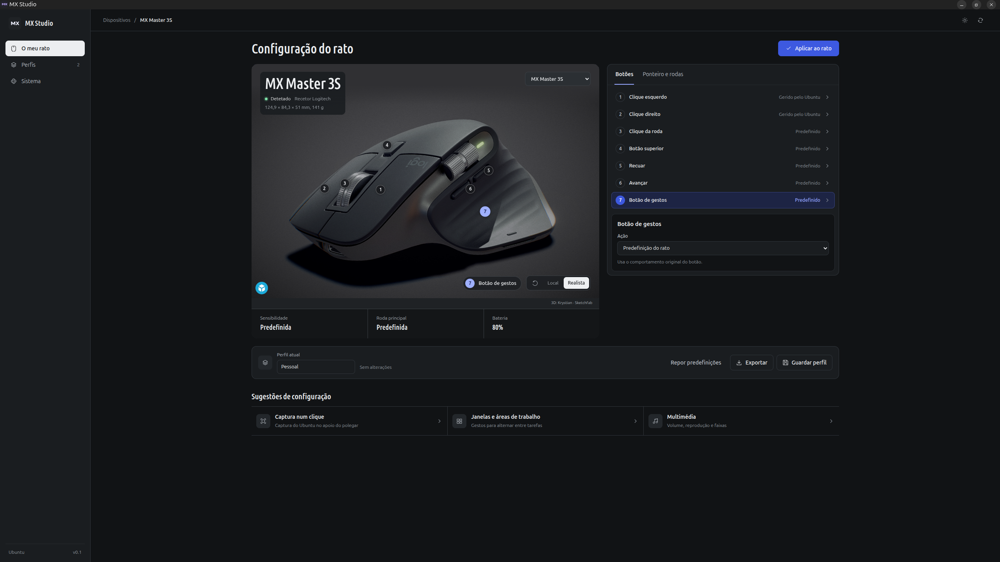

# MX Studio

Aplicação local para configurar os Logitech **MX Master 3S e 4** no Ubuntu. Interface em português de Portugal, representação 3D interativa, seleção dos botões e perfis guardados no computador.



## Abrir

Na pasta do projeto:

```bash
bash start.sh
```

É necessário Python 3.10 ou posterior. Os visualizadores dos modelos Sketchfab abrem por predefinição quando há ligação à Internet. A vista **Local** já está incluída: **não é necessário instalar pacotes npm nem ter Internet para abrir e configurar a aplicação**.

O Chrome/Chromium abre uma janela de aplicação. Quando não está instalado, abre o navegador predefinido. O servidor fica a correr no terminal; termina-o com `Ctrl+C`. Fechar a janela não termina o servidor.

Também podes executar `python3 app.py --no-open` e abrir `http://127.0.0.1:48731`. Se a porta estiver ocupada, usa `python3 app.py --port 48732`. Não abras `web/index.html` diretamente: a interface precisa do servidor local.

## Aplicar configurações no Ubuntu

Para MX Master 3S:

```bash
sudo apt install logiops solaar
sudo bash scripts/install-system.sh
bash start.sh
```

Para **MX Master 4**, usa uma versão recente do [LogiOps](https://github.com/PixlOne/logiops) que inclua suporte ao modelo. O pacote do Ubuntu 24.04 é 0.3.3 e pode não reconhecer o MX Master 4. A instalação a partir do código-fonte está documentada pelo projeto LogiOps. Depois executa `sudo bash scripts/install-system.sh`.

Na aplicação, escolhe o rato detetado, personaliza os botões e carrega em **Aplicar ao rato**. A autorização de administrador é pedida pelo `pkexec` do Ubuntu. Guardar um perfil, carregar uma sugestão ou exportar **não altera o rato**.

A instalação copia apenas o auxiliar de aplicação e o validador para uma pasta protegida, pertencente a root. O processo gráfico não corre como administrador. Se alterares `mxstudio/config.py` ou `scripts/apply.py`, volta a executar o instalador para atualizar essas cópias.

## Funcionalidades

| Área | Disponível |
| --- | --- |
| Deteção | Linux HID e consulta ao Solaar; Bluetooth e recetor, quando o modelo é identificável |
| 3D | Vista Realista com os modelos texturizados do 3S e do 4 for Mac Space Black nos visualizadores oficiais Sketchfab, com rotação e zoom; vista Local com seleção de botões, vistas topo/lado e acabamentos Grafite ou Cinza claro |
| Botões | Clique da roda, superior, recuar, avançar, gestos; apoio do polegar adicional no MX Master 4 |
| Ações | Captura de ecrã, janelas, áreas de trabalho, edição, separadores, multimédia e atalhos personalizados |
| Gestos | Clique sem movimento e quatro direções; ações ao soltar |
| Ponteiro | DPI com limites por modelo; alternância entre 800, 1600 e 2400 DPI |
| Rodas | SmartShift, limiar, alta resolução, inversão e roda lateral para volume/separadores/zoom |
| Perfis | Nome, guardar, carregar e exportar `logid.cfg` |
| Sugestões | Print Screen no polegar, produtividade e multimédia |
| Aplicação | Autorização pelo Ubuntu, cópia de segurança e reposição se o serviço não arrancar |

Os botões principais esquerdo/direito são apresentados mas geridos pelas Definições do Ubuntu. Os atalhos usam as predefinições GNOME; podem precisar de adaptação quando os teus atalhos ou a disposição do teclado são diferentes. A gravação de teclas usa códigos físicos do teclado. Certas combinações reservadas pelo sistema/navegador não chegam à gravação; nesses casos usa uma ação predefinida.

A ação «Captura de ecrã» lê o atalho atual `org.gnome.shell.keybindings show-screenshot-ui` na sessão do utilizador ao aplicar ou exportar, incluindo quando é usada num gesto. Por exemplo, se o Ubuntu usar `Super+Shift+S`, essa combinação substitui o Print Screen. Se alterares o atalho no Ubuntu, volta a aplicar o perfil. Não é alterado nenhum atalho do sistema.

## Limites e comportamento

- A pré-visualização nunca é apresentada como um rato ligado. Um recetor genérico não chega para identificar o modelo. Uma bateria desconhecida não é estimada.
- O seletor e a deteção incluem apenas MX Master 3S e 4. Os perfis antigos do MX Master 3 deixam de aparecer, mas são preservados no disco e na configuração aplicada existente.
- Os modelos Sketchfab indicados têm a transferência desativada. A vista **Realista** usa os visualizadores oficiais: [MX Master 3S por Krystian](https://sketchfab.com/3d-models/logitech-mx-master-3s-e3f9cfe03c0e4aa79570cfd2402e65fd) e [MX Master 4 for Mac Space Black por JAllen2026](https://sketchfab.com/3d-models/910-007575-mx-master-4-mac-space-black-3d2ad75a27cd4b7d96c86b34719bedaf). Um crédito discreto aparece sob o modelo. Os parâmetros oficiais pedem para ocultar Help, dicas, menus, anotações, controlos e marca do visualizador. Segundo a [documentação Sketchfab](https://sketchfab.com/developers/viewer/initialization), várias destas opções exigem um plano Premium do proprietário do modelo e podem ser ignoradas quando não está disponível. Nesta vista, seleciona os botões na lista. Se o visualizador não carregar, escolhe **Local**.
- A vista Local do 3S usa o CAD já incluído (`web/models/mx3s.glb`, convertido de STEP com `tools/step2glb.py`; peças separadas por `tools/mx3s_rules.py`). O MX Master 4 usa um modelo procedural. Estas vistas permitem selecionar os botões no próprio modelo e funcionam sem Internet. Se o GLB do 3S não carregar, a aplicação usa o modelo procedural. O MX Master 4 inclui o CID `0x01a0`.
- Na vista Realista, o iframe é `inert`, não recebe cliques nem foco de teclado e usa `sandbox` sem permissões de popups, navegação da página principal, formulários, diálogos ou downloads. A aplicação controla apenas a câmara através do SDK oficial Sketchfab 1.12.1, incluído em `web/vendor`. Arrastar roda o modelo, a roda ou o gesto de pinça fazem zoom; as setas, `+`, `-` e `Home` permitem usar o teclado. O mini crédito é texto sem links. Estes bloqueios impedem interações com a interface externa; não removem elementos visuais cuja ocultação o Sketchfab recuse.
- Não estão implementados feedback háptico, Actions Ring, Logitech Flow, perfis automáticos por aplicação ou escrita na memória interna do rato.
- As capacidades de cada botão dependem do firmware e do LogiOps. Esta versão usa os mapas documentados, não interroga todas as capacidades HID++ em tempo real.
- Os nomes usados pelo controlador são `MX Master 3S` e `MX Master 4`. Variantes com outro nome de dispositivo, incluindo algumas versões «for Mac», podem precisar de um nome adicional no compilador.
- Os perfis aplicam-se por modelo. Dois ratos com o mesmo nome recebem a mesma configuração. Os perfis guardados não são aplicados automaticamente ao abrir a interface.
- Não remapeies os mesmos controlos simultaneamente com regras do Solaar e do LogiOps.
- O estado «aplicado» confirma a escrita da configuração e o arranque do serviço; não confirma fisicamente a resposta de cada botão. Verifica-os no rato.
- Os campos predefinidos são omitidos da configuração. Isso remove remapeamentos desta aplicação, mas não garante uma reposição de todos os valores persistentes do firmware.
- Um `/etc/logid.cfg` vazio ou apenas com comentários (como o exemplo instalado pelo pacote Ubuntu) é aceite; o original fica numa cópia de segurança. Se contiver uma configuração ativa criada fora desta aplicação, a primeira aplicação continua a ser recusada: exporta e integra manualmente nesse caso.

Os perfis da interface ficam em `data/profiles.json` junto ao projeto. Podes definir outro diretório com `MX_STUDIO_DATA_DIR`. Os perfis aplicados ficam em `/var/lib/mx-studio/active.json`; as cópias anteriores estão em `/var/lib/mx-studio/backups`. O ficheiro do controlador é `/etc/logid.cfg`.

## Diagnóstico

A página **Sistema** apresenta os dispositivos, sessão, controlador e permissões. Se o rato não for detetado:

```bash
solaar show
systemctl status logid
journalctl -u logid --no-pager -n 50
```

Confirma que o rato está ligado e acordado, e que as regras udev do Solaar/LogiOps estão instaladas. Depois de instalar as regras pode ser necessário voltar a ligar o recetor ou iniciar nova sessão. A configuração pelo LogiOps usa dispositivos de entrada virtuais, sendo apropriada para Wayland sem depender do `xdotool`.

## Desenvolvimento e testes

```bash
python3 -m unittest discover -s tests -v
node --check web/app.js
node --check web/scene.js
node --check web/model-viewer.js
npm run test:viewer
```

Python usa apenas a biblioteca padrão. A interface usa módulos JavaScript e Three.js 0.180.0, incluído em `web/vendor` com a licença MIT original. `package.json` documenta a dependência; `node_modules` não é necessário para executar a aplicação.

Os testes cobrem os modelos, CIDs, DPI, gestos, teclas permitidas, deteção offline/Bluetooth, persistência, exportação, proteção da API e bloqueio de aplicação em pré-visualização. A API é exercitada através do handler HTTP real, com transporte em memória, sem abrir sockets.

**Validação desta alteração:** 43 testes Python passaram, assim como as verificações de sintaxe JavaScript. O controlador da interface foi exercitado com um DOM simulado para verificar a troca dos modelos e créditos, a vista Local, a perda de Internet e a ausência de WebGL. A API também respondeu através do servidor local. A inspeção visual ficou por fazer porque o navegador de inspeção está indisponível; o funcionamento físico dos botões não foi testado.

## Referências

- [Dispositivos testados pelo LogiOps](https://github.com/PixlOne/logiops/blob/main/TESTED.md)
- [Formato da configuração](https://github.com/PixlOne/logiops/wiki/Configuration)
- [Identificadores dos botões](https://github.com/PixlOne/logiops/wiki/CIDs)
- [Mapeamento do MX Master 4](https://github.com/PixlOne/logiops/issues/520)
- [Solaar](https://github.com/pwr-Solaar/Solaar)
